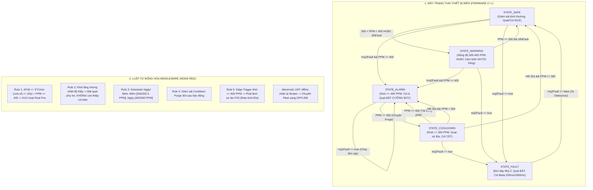

# Kế Hoạch Khắc Phục Toàn Diện & Chuẩn Hóa Mã Nguồn Dự Án IoT (Phiên bản v4)
## Đề tài 04: Hệ thống Báo khói Cảnh báo sớm | Nhóm 04 (N09) - HUIT

---

## 1. Mục Tiêu & Bối Cảnh (Goal Description)

Sau 3 vòng phản biện chuyên sâu và tiếp thu ý kiến từ External AI Agent (Claude), kế hoạch này thiết lập **Bản Đặc Tả Kỹ Thuật Chuẩn Mực Cuối Cùng (Phiên bản v4)**. Mọi chi tiết kỹ thuật được tính toán chính xác về mặt số học, thời gian thực thi, an toàn phòng cháy chữa cháy (PCCC) và chuẩn hóa kiến trúc 4 tầng IoT:
1. **Khắc phục toàn diện các lỗi an toàn và lỗi logic nhúng phát sinh:**
   - **Kẹp ngưỡng an toàn thích ứng:** Ngưỡng báo động từ Server được kẹp chặt trong dải $[300.0..400.0]\text{ PPM}$ (chỉ cho phép hạ ngưỡng, không vượt quá ngưỡng mặc định 400 PPM), tự động tính lại `safeThreshold = alarmThreshold * 0.75f` (luôn $> 225\text{ PPM}$, tuyệt đối không bị kẹt dưới mức nền $\approx 200\text{ PPM}$ của Wokwi).
   - **Bảo toàn bộ lọc EMA khi lỗi cảm biến:** Đóng băng EMA khi `mq2Fault == true` (không nạp giá trị 0 làm sai lệch bộ đệm); gọi `resetEmaFilter(validRawPPM)` ngay khi cảm biến hồi phục sau 3 chu kỳ debounce.
   - **Cơ chế Local Acknowledge Silence (Nút bấm vật lý):** Giải tỏa còi chốt khi cảm biến đứt dây trong lúc cháy bằng nút nhấn tại chỗ (tắt còi 60s cho nhân viên xử lý hiện trường, quạt hút vẫn cưỡng bức chạy; tự động kích hoạt lại sau 60s nếu sự cố chưa dứt). Lệnh MUTE từ xa qua MQTT vẫn bị từ chối 100%.
   - **Tối ưu hóa ngắt âm thanh `tickFaultBeep`:** Chỉ ghi thanh ghi LEDC khi có sự thay đổi trạng thái pha (`wantOn != s_beepOn`), triệt tiêu việc ghi liên tục hàng nghìn lần mỗi giây làm nghẽn CPU và méo tần số còi.
   - **Tách biệt hai biến Exponential Backoff:** `s_wifiBackoffMs` và `s_mqttBackoffMs` ($1\text{s} \to 16\text{s}$) hoạt động độc lập, không làm trễ lẫn nhau và tránh gọi `WiFi.begin()` lặp vòng khi đang kết nối.
2. **Khôi phục và chuẩn hóa toàn bộ Middleware Node-RED:**
   - Đặt `topic: ""` trong node `mqtt_out_buzzer_downlink` để giải phóng dynamic topic cho Rule 5.
   - Kích hoạt Rule 5 theo sườn xung (Edge Trigger: chỉ phát khi mới vượt ngưỡng 600 PPM) kèm giới hạn tần suất 60s; gửi lệnh tới từng trạm cụ thể trong tầng F03.
   - Khôi phục tính toán gia tốc nhiệt $dT/dt$ Rule 1 theo cửa sổ $\ge 20\text{s}$ độc lập cho từng thiết bị; đặt đúng khối Rule 4 trong nhánh xử lý Telemetry.
   - Đồng bộ trạng thái `dhtFault` vào FSM (chuyển `STATE_WARNING` - Degraded Mode) ở cả Firmware và Node-RED.
3. **Chuẩn hóa hồ sơ nghiệm thu và kiểm thử trung thực:**
   - Cập nhật số liệu thực tế về bộ lọc EMA: Xung đơn mẫu đến $\sim 800\text{ PPM}$ (từ nền 120 PPM) được triệt tiêu hoàn toàn $< 400\text{ PPM}$; bước nhảy khói $\ge 600\text{ PPM}$ kích hoạt báo động sau 2 chu kỳ ($\approx 4\text{s}$).
   - Viết lại Phần VII (Audit Matrix) trong `scratch/build_dossier.py` để phản ánh đúng hiện trạng mã nguồn thực tế.
   - Bổ sung kiểm thử đơn vị C++ Native (Unity/PlatformIO) kiểm chứng trực tiếp FSM và thuật toán EMA trên mã nguồn thật.

---

## 2. Bảng Phân Tích & Tiếp Thu Phản Biện Chuyên Sâu (Claude Agent v3 $\to$ v4)

| STT | Vấn Đề Claude Agent Nêu Ra | Cơ Sở Toán Học & Kỹ Thuật | Giải Pháp Triệt Để Trong Phiên Bản v4 |
| :---: | :--- | :--- | :--- |
| **1** | **Ràng buộc ngưỡng B4 làm kẹt FSM trong ALARM** | Nền Wokwi là 200 PPM. Nếu cho phép server đặt alarm = 250 thì safe = 187.5 PPM. Khói phòng không bao giờ hạ dưới 187.5 PPM $\implies$ FSM kẹt vĩnh viễn ở ALARM. Dùng `min` làm mất khả năng khôi phục safe khi alarm tăng lại 400. Cận 450 vi phạm nguyên tắc "chỉ hạ ngưỡng". | **Ràng buộc 2 phía & Tính lại Safe:**<br>`alarm = constrain(srvAlarm, 300.0f, DEFAULT_ALARM_PPM_DAY);`<br>`safe = alarm * 0.75f;`<br>Đảm bảo $safe \in [225.0..300.0]\text{ PPM}$, luôn cao hơn mức nền 200 PPM của Wokwi. |
| **2** | **EMA không được reset khi cảm biến phục hồi** | Trong lúc MQ-2 đứt, PPM $\approx 0$ kéo EMA tụt dốc về 0. Khi cắm lại cảm biến giữa lúc đang có khói 450 PPM, EMA mất 10s mới leo qua 400 PPM, gây trễ báo động nghiêm trọng. | **Đóng băng & Reset EMA:**<br>- Khi `mq2Fault == true`: Bỏ qua cập nhật EMA.<br>- Khi MQ-2 phục hồi (Debounce 3x): Gọi `resetEmaFilter(validRawPPM)` với mẫu đo thực tế đầu tiên.<br>- Telemetry gửi `mq2_valid: false` khi cảm biến hỏng. |
| **3** | **Số liệu EMA trong tài liệu chưa chính xác** | Với nền 120 PPM, $\alpha_{rise}=0.40$:<br>- Xung đơn lẻ 800 PPM: $EMA_1 = 120 + 0.4 \times (800 - 120) = 392 < 400\text{ PPM}$ (Triệt tiêu!).<br>- Bước nhảy 600 PPM: mẫu 1 = 312 PPM, mẫu 2 = 427.2 PPM ($\ge 400\text{ PPM} \implies \approx 4\text{s}$).<br>- Bước nhảy 450 PPM: cần 4 mẫu ($\approx 8\text{s}$). | **Hiệu chỉnh tài liệu & Test Case:** Viết đúng bản chất vật lý: "Xung gai đơn mẫu đến $\sim 800\text{ PPM}$ không gây báo động giả; nồng độ khói duy trì $\ge 600\text{ PPM}$ báo động trong $\le 4\text{s}$". Cập nhật bài test kiểm chứng xung 800 PPM và bước nhảy 600 PPM. |
| **4** | **Còi báo động chốt vĩnh viễn khi cháy làm đứt cáp cảm biến** | Nhánh `mq2Fault && autoOverrideActive` giữ còi hú liên tục, trong khi lệnh MUTE từ xa bị chặn vì đang ALARM $\implies$ Không có cách nào dập còi nếu không rút nguồn. | **Cơ chế Local Acknowledge Silence (Nút bấm vật lý):** Nhấn nút bấm tại chỗ cho phép người vận hành ngắt còi tạm thời 60s (`LOCAL_ACK_SILENCE`), quạt vẫn duy trì hút khói. Hết 60s còi tự động hú lại nếu lỗi chưa khắc phục. MUTE từ xa qua MQTT vẫn bị cấm tuyệt đối. |
| **5** | **Thiếu sót trong mã nguồn Middleware Node-RED** | Node `mqtt out` bị sót trường `topic: ""` làm đè topic động; Rule 1 mất tính toán $dT/dt$; nhánh Rule 4 bị dán nhầm vào khối xử lý Fault Injection. | **Khôi phục toàn diện Node-RED:**<br>- Đặt `topic: ""` ở node buzzer downlink.<br>- Khôi phục tính $dT/dt$ cửa sổ trượt $\ge 20\text{s}$ theo từng `deviceId`.<br>- Đặt đúng Rule 4 vào luồng phân tích Telemetry. |
| **6** | **Rule 5 phát sóng liên tục mỗi gói tin 2s** | Điều kiện `ppm >= 600` chạy mỗi chu kỳ telemetry làm ngập broker các bản tin UNMUTE tới các phòng lân cận. Fleet Registry không có phòng mặc định. | **Kích hoạt theo cạnh & Giới hạn tốc độ:** Chỉ kích hoạt khi khói chuyển từ $< 600$ lên $\ge 600$ PPM (Edge Trigger) kèm Rate Limit tối thiểu 60s giữa 2 lần phát. Gửi trực tiếp tới các trạm cùng tầng F03 đã đăng ký. |
| **7** | **Exponential Backoff dùng chung gây tắc nghẽn kép** | Retry WiFi làm tăng biến backoff lên 16s khiến MQTT lần đầu phải chờ 16s vô lý. Gọi `WiFi.begin()` liên tục khi đang kết nối dở làm reset tiến trình Wi-Fi. | **Tách biệt 2 máy phát Backoff:**<br>`s_wifiBackoffMs` và `s_mqttBackoffMs` riêng biệt. Chỉ gọi `WiFi.reconnect()` khi Wi-Fi mất hẳn; reset về 1000ms ngay khi kết nối thành công. |
| **8** | **`tickFaultBeep` ghi LEDC liên tục gây nhiễu** | Gọi `ledcWriteTone`/`ledcWrite` trong mỗi vòng `loop()` hàng nghìn lần/giây làm méo tín hiệu PWM và hao tổn chu kỳ xử lý. | **Chuyển trạng thái theo cạnh (Edge Detection):** Lưu biến trạng thái `s_beepOn`, chỉ ghi LEDC khi `wantOn != s_beepOn` (đúng 2 lần trong 1 chu kỳ 2s). |
| **9** | **Lệch pha giữa Sơ đồ FSM, Code và Tài liệu** | Sơ đồ ghi DHT hỏng vào WARNING nhưng code không nhận; COOLDOWN về SAFE chưa kiểm tra PPM; Audit Matrix trong `build_dossier.py` sinh ra tuyên bố sai. | **Đồng bộ hóa 100%:**<br>- Truyền `dhtFault` vào `updateFsmLogic` để chuyển `STATE_WARNING` khi DHT hỏng.<br>- Kiểm tra `PPM <= safeThreshold` trước khi rời COOLDOWN về SAFE.<br>- Viết lại Section VII của `build_dossier.py` theo đúng hiện trạng kỹ thuật thực tế. |
| **10** | **XSS SCADA & Bắt lỗi cú pháp JSON** | Bỏ qua gói tin JSON lỗi không có phản hồi ACK; thay đổi `addAuditLog` làm vỡ mảng `STATE.logs`; so sánh trạng thái `prevState` trong `loop()` bị sai thời điểm. | **Hoàn thiện cấu trúc hiện có:**<br>- Trả về ACK `REJECTED_BAD_PAYLOAD` khi deserialize JSON thất bại.<br>- Giữ nguyên mảng `STATE.logs` và lọc `escapeHtml` ngay trong `renderAuditTable`.<br>- Lấy mẫu `prevState` trước khi gọi `checkSensorHealth`. |

---

## 3. Kiến Trúc Máy Trạng Thái Đồng Bộ (Unified State Machine Specification)

Kiến trúc phân định rành mạch giữa **Máy trạng thái nhúng tại Biên (Firmware FSM)** và **Hệ thống Luật Middleware Giám Sát (Node-RED Automation)**:



---

## 4. Chi Tiết Triển Khai Mã Nguồn (Detailed Implementation Specs)

### Component 1: Firmware C++ (`src/`)

#### [MODIFY] `src/config.h`
```cpp
#define DEVICE_ID             "ESP32_SMOKE_N04_A01"
#define EMA_ALPHA_RISE        0.40f  // Khói tăng: bước 600 PPM báo cháy trong 4s (2 chu kỳ)
#define EMA_ALPHA_FALL        0.15f  // Khói giảm: lọc phẳng dao động
#define FAULT_DEBOUNCE_COUNT  3      // 3 lần đọc tốt liên tiếp để hồi phục
#define RECONNECT_BACKOFF_MIN 1000   // 1s
#define RECONNECT_BACKOFF_MAX 16000  // 16s (Exponential Backoff)
#define LOCAL_ACK_MUTE_MS     60000  // 60s dập còi tạm thời khi nhấn nút tại chỗ lúc báo động
```

#### [MODIFY] `src/fsm.h`
```cpp
void updateFsmLogic(FsmContext& ctx, float currentPPM, const SensorConfig& cfg, bool mq2Fault, bool dhtFault);
void tickFaultBeep(FsmContext& ctx);
```

#### [MODIFY] `src/fsm.cpp`
```cpp
void updateFsmLogic(FsmContext& ctx, float currentPPM, const SensorConfig& cfg, bool mq2Fault, bool dhtFault) {
  // 1. Ưu tiên 1: Cháy thật khẩn cấp (MQ-2 hoạt động bình thường và nồng độ vượt ngưỡng)
  if (!mq2Fault && currentPPM >= cfg.alarmThreshold) {
    ctx.inCooldownPurge = false;
    ctx.currentState = STATE_ALARM;
    ctx.isMuted = false; // Bắt buộc hủy mute khi khói bùng phát

    if (!ctx.autoOverrideActive) {
      ctx.autoOverrideActive = true;
      Serial.println(F("  >>> [CANH BAO PCCC] PPM >= Nguong -> COI & QUAT BAT CUONG BUC! <<<"));
    }
    setActuatorBuzzer(ctx, true);
    setActuatorFan(ctx, true);
    return;
  }

  // 2. Cháy làm đứt cáp cảm biến MQ-2 (đang ALARM mà mq2Fault = true)
  // Duy trì báo động liên tục và quạt chạy hết công suất!
  if (mq2Fault && ctx.autoOverrideActive) {
    ctx.currentState = STATE_ALARM;
    setActuatorBuzzer(ctx, true);
    setActuatorFan(ctx, true);
    return;
  }

  // 3. Sự cố đứt dây MQ-2 ở điều kiện thường (Fail-Safe: Quạt hút khói, còi Beep lỗi)
  if (mq2Fault) {
    ctx.currentState = STATE_FAULT;
    ctx.inCooldownPurge = false;
    setActuatorFan(ctx, true);
    setActuatorBuzzer(ctx, false); // Còi chính tắt, nhường cho tickFaultBeep()
    return;
  }

  // 4. Duy trì ALARM hoặc chuyển tiếp COOLDOWN PURGE (Bảo toàn Hysteresis)
  if (ctx.autoOverrideActive) {
    if (currentPPM > cfg.safeThreshold) {
      ctx.currentState = STATE_ALARM;
      setActuatorBuzzer(ctx, true);
      setActuatorFan(ctx, true);
      return;
    }
    // Khói đã hạ <= safeThreshold: Kích hoạt 30s Cooldown Purge
    ctx.autoOverrideActive = false;
    ctx.inCooldownPurge = true;
    ctx.cooldownStartTime = millis();
    ctx.currentState = STATE_COOLDOWN;
    setActuatorBuzzer(ctx, false);
    setActuatorFan(ctx, true);
    Serial.println(F("  --- [COOLDOWN PURGE] Khoi an toan. Bat dau thong gio cuong buc 30s! ---"));
    return;
  }

  // 5. Quản lý trạng thái COOLDOWN
  if (ctx.inCooldownPurge) {
    if (millis() - ctx.cooldownStartTime >= COOLDOWN_PURGE_MS) {
      ctx.inCooldownPurge = false;
      // KIỂM TRA LẠI PPM TRƯỚC KHI VỀ SAFE
      if (currentPPM <= cfg.safeThreshold) {
        ctx.currentState = dhtFault ? STATE_WARNING : STATE_SAFE;
        const bool fanTarget = (ctx.mode == MODE_AUTO) ? false : ctx.manualFanState;
        setActuatorFan(ctx, fanTarget);
        Serial.println(F("  --- [PURGE HOAN TAT] Het 30s. He thong ve SAFE/WARNING IDLE ---"));
      } else {
        // Nếu khói bùng phát lại trong lúc cooldown hết hạn
        ctx.currentState = STATE_ALARM;
        ctx.autoOverrideActive = true;
        setActuatorBuzzer(ctx, true);
        setActuatorFan(ctx, true);
      }
    } else {
      ctx.currentState = STATE_COOLDOWN;
      setActuatorFan(ctx, true);
    }
    return;
  }

  // 6. Trạng thái WARNING: Khói trong vùng [safe..alarm] HOẶC DHT22 hỏng đơn lẻ
  if (currentPPM > cfg.safeThreshold || dhtFault) {
    ctx.currentState = STATE_WARNING;
    setActuatorBuzzer(ctx, false);
    const bool normalFan = (ctx.mode == MODE_AUTO) ? false : ctx.manualFanState;
    setActuatorFan(ctx, normalFan);
    return;
  }

  // 7. Trạng thái SAFE bình thường
  ctx.currentState = STATE_SAFE;
  setActuatorBuzzer(ctx, false);
  const bool normalFan = (ctx.mode == MODE_AUTO) ? false : ctx.manualFanState;
  setActuatorFan(ctx, normalFan);
}

// Bổ sung phát hiện cạnh, chỉ ghi LEDC đúng 2 lần trong 1 chu kỳ 2s
void tickFaultBeep(FsmContext& ctx) {
  if (ctx.currentState != STATE_FAULT) return;
  static bool s_beepOn = false;
  const bool wantOn = (millis() % 2000) < 200;

  if (wantOn != s_beepOn) {
    s_beepOn = wantOn;
    if (s_beepOn) {
      ledcWriteTone(BUZZER_LEDC_CH, BUZZER_TONE_TEST_HZ);
      ledcWrite(BUZZER_LEDC_CH, BUZZER_DUTY_50PCT);
    } else {
      ledcWrite(BUZZER_LEDC_CH, BUZZER_DUTY_OFF);
      ledcWriteTone(BUZZER_LEDC_CH, 0);
    }
  }
}
```

#### [MODIFY] `src/sensors.h` & `src/sensors.cpp`
```cpp
static float s_emaPPM = -1.0f;

float filterAsymmetricEMA(float rawPPM, bool isFaulted) {
  if (isFaulted) {
    // Đóng băng EMA khi cảm biến hỏng, không nạp mẫu rác
    return s_emaPPM;
  }
  if (s_emaPPM < 0.0f) {
    s_emaPPM = rawPPM;
    return rawPPM;
  }
  const float alpha = (rawPPM > s_emaPPM) ? EMA_ALPHA_RISE : EMA_ALPHA_FALL;
  s_emaPPM = (alpha * rawPPM) + ((1.0f - alpha) * s_emaPPM);
  return s_emaPPM;
}

void resetEmaFilter(float initialPPM) {
  s_emaPPM = initialPPM;
}
```

#### [MODIFY] `src/main.cpp`
- **Tách biệt 2 máy phát Backoff và chống loop spam `WiFi.begin()`:**
  ```cpp
  static unsigned long s_wifiBackoffMs = RECONNECT_BACKOFF_MIN;
  static unsigned long s_mqttBackoffMs = RECONNECT_BACKOFF_MIN;

  static void maintainNetworkConnection() {
    const unsigned long now = millis();

    // 1. Maintain WiFi
    if (WiFi.status() != WL_CONNECTED) {
      if (now - g_lastWifiRetry >= s_wifiBackoffMs) {
        g_lastWifiRetry = now;
        Serial.printf("[WIFI] Dang ket noi lai... (Backoff: %lu ms)\r\n", s_wifiBackoffMs);
        WiFi.disconnect();
        WiFi.begin(WIFI_SSID, WIFI_PASS);
        s_wifiBackoffMs = min(s_wifiBackoffMs * 2, (unsigned long)RECONNECT_BACKOFF_MAX);
      }
      return;
    }
    s_wifiBackoffMs = RECONNECT_BACKOFF_MIN; // Reset ngay khi WiFi có kết nối

    // 2. Maintain MQTT
    if (!g_mqttClient.connected()) {
      if (now - g_lastMqttRetry >= s_mqttBackoffMs) {
        g_lastMqttRetry = now;
        Serial.printf("[MQTT] Dang ket noi Broker... (Backoff: %lu ms)\r\n", s_mqttBackoffMs);
        const char* lwtMsg = "{\"device_id\":\"ESP32_SMOKE_N04_A01\",\"status\":\"offline\"}";
        if (g_mqttClient.connect(g_clientId, TOPIC_LWT, 1, true, lwtMsg)) {
          s_mqttBackoffMs = RECONNECT_BACKOFF_MIN; // Reset khi MQTT thành công
          // Subscribe topics và gửi online...
        } else {
          s_mqttBackoffMs = min(s_mqttBackoffMs * 2, (unsigned long)RECONNECT_BACKOFF_MAX);
        }
      }
    } else {
      g_mqttClient.loop();
    }
  }
  ```

- **Xử lý Nút nhấn vật lý (Local Acknowledge Silence):**
  ```cpp
  static void handleManualButton() {
    // ... Debounce logic ...
    if (g_stableButtonState == LOW) {
      if (g_fsm.currentState == STATE_ALARM || g_fsm.autoOverrideActive) {
        // LOCAL ACKNOWLEDGE: Người vận hành tại chỗ xác nhận sự cố, tạm ngắt còi 60s
        g_fsm.isMuted = true;
        g_fsm.muteStartTime = millis();
        g_fsm.muteDurationMs = LOCAL_ACK_MUTE_MS;
        setActuatorBuzzer(g_fsm, false);
        setActuatorFan(g_fsm, true); // Quạt hút bắt buộc giữ ON
        Serial.println(F("\r\n[LOCAL BUTTON] Xác nhận tại chỗ: Tạm ngắt còi 60s, quạt duy trì hút khói!"));
        publishStatusAck("button_press", "ACCEPTED_LOCAL_SILENCE", "MUTED_60S_FAN_ON");
      } else {
        // Thao tác bật/tắt quạt thủ công ở chế độ bình thường
        g_fsm.manualFanState = !g_fsm.manualFanState;
        g_fsm.mode = MODE_MANUAL;
        setActuatorFan(g_fsm, g_fsm.manualFanState);
        publishStatusAck("button_press", "ACCEPTED", g_fsm.manualFanState ? "FAN_ON" : "FAN_OFF");
      }
    }
  }
  ```

- **Ràng buộc an toàn ngưỡng nhận từ Server:**
  ```cpp
  if (doc["config"]["alarm_threshold_ppm"]) {
    float srv = doc["config"]["alarm_threshold_ppm"];
    // Chỉ cho phép hạ ngưỡng, chặn dưới 300 PPM (tránh kẹt trên nền 200 PPM của Wokwi)
    g_cfg.alarmThreshold = constrain(srv, 300.0f, (float)DEFAULT_ALARM_PPM_DAY);
    g_cfg.safeThreshold  = g_cfg.alarmThreshold * 0.75f; // Luôn tính lại
    Serial.printf("Dong bo hop le: Alarm = %.1f PPM, Safe = %.1f PPM\r\n", g_cfg.alarmThreshold, g_cfg.safeThreshold);
  }
  ```

- **Lấy mẫu `prevState` chuẩn xác trong `loop()`:**
  ```cpp
  void loop() {
    maintainNetworkConnection();
    handleManualButton();
    checkMuteTimer(g_fsm);
    tickFaultBeep(g_fsm);

    const unsigned long now = millis();
    if (now - g_lastMQ2Time >= g_cfg.intervalMQ2) {
      g_lastMQ2Time = now;

      // 1. Lưu lại prevState TRƯỚC KHI chẩn đoán sức khỏe và FSM
      const SystemState prevState = g_fsm.currentState;

      const float rawPPM = readMQ2PPM(g_cfg, g_r0);
      g_currentPPM = filterAsymmetricEMA(rawPPM, g_health.mq2Fault);

      const bool prevMq2Fault = g_health.mq2Fault;
      checkSensorHealth(g_currentTemp, g_currentHum, g_simFaultMQ2, g_simFaultDHT, g_health, g_fsm.currentState);

      // Nếu vừa hồi phục từ lỗi MQ-2 -> Reset EMA với mẫu hợp lệ đầu tiên
      if (prevMq2Fault && !g_health.mq2Fault) {
        resetEmaFilter(readMQ2PPM(g_cfg, g_r0));
      }

      updateFsmLogic(g_fsm, g_currentPPM, g_cfg, g_health.mq2Fault, g_health.dhtFault);

      // Chỉ publish event khi thực sự chuyển trạng thái
      if (g_fsm.currentState == STATE_ALARM && prevState != STATE_ALARM) {
        publishAlarmEvent(g_currentPPM, true);
      } else if (g_fsm.currentState == STATE_COOLDOWN && prevState == STATE_ALARM) {
        publishAlarmEvent(g_currentPPM, false);
      }

      publishTelemetry();
    }
  }
  ```

---

### Component 2: Middleware Node-RED (`nodered/generate_flows.py`)

#### 1. Đặt `topic: ""` ở Node Downlink Buzzer (Hỗ trợ Rule 5 động)
```python
{
    "id": "mqtt_out_buzzer_downlink",
    "type": "mqtt out",
    "z": flow_tab_id,
    "name": "Dynamic Downlink Buzzer / Cross-Zone",
    "topic": "",  # ĐỂ TRỐNG ĐỂ NODE-RED DÙNG msg.topic TỰ ĐỘNG
    "qos": "1",
    "retain": "false",
    "broker": broker_id,
    "x": 1410,
    "y": 480,
    "wires": []
}
```

#### 2. Khôi phục Rule 1 ($dT/dt$), Rule 4 & Rule 5 (Edge Trigger) trong Core Engine:
```javascript
// ==========================================
// XỬ LÝ TELEMETRY & BUSINESS RULES
// ==========================================
if (msg.eventType === "TELEMETRY") {
    let devId = msg.deviceId || "ESP32_SMOKE_N04_A01";
    let ppm = msg.ppm;
    let temp = msg.temp;
    let hum = msg.hum;

    // RULE 1: Quản lý gia tốc nhiệt dT/dt theo từng thiết bị (cửa sổ >= 20s)
    let devState = flow.get("dev_state_" + devId) || {
        lastTemp: temp,
        lastTempTime: now,
        rateOfRise: 0.0,
        lastPpm: ppm
    };

    let dtSeconds = (now - devState.lastTempTime) / 1000.0;
    if (dtSeconds >= 20.0) {
        devState.rateOfRise = (temp - devState.lastTemp) / (dtSeconds / 60.0);
        devState.lastTemp = temp;
        devState.lastTempTime = now;
    }

    let isRealFire = (ppm >= ALARM_THRESHOLD) && (devState.rateOfRise >= 3.0 || temp >= 50.0);
    let isTransientSmoke = (ppm >= ALARM_THRESHOLD && temp < 35.0 && devState.rateOfRise < 1.0);

    if (isRealFire) {
        state = "ALARM";
        commands.push({ topic: "Nhom09/smoke/cmd/fan", payload: { action: "ON", priority: "CRITICAL", reason: "RULE_1_REAL_FIRE" } });
        commands.push({ topic: "Nhom09/smoke/cmd/buzzer", payload: { action: "UNMUTE", priority: "CRITICAL" } });
    } else if (isTransientSmoke) {
        commands.push({ topic: "Nhom09/smoke/cmd/fan", payload: { action: "ON", reason: "RULE_2_PURGE_VENTILATION" } });
        // KHÔNG GỬI MUTE COI TỪ CLOUD!
    } else if (ppm >= ALARM_THRESHOLD) {
        state = "ALARM";
        commands.push({ topic: "Nhom09/smoke/cmd/fan", payload: { action: "ON", reason: "STANDARD_ALARM" } });
    }
    // RULE 4: Cooldown Purge Hysteresis (ĐẶT ĐÚNG TRONG NHÁNH TELEMETRY)
    else if (state === "ALARM" && ppm <= SAFE_THRESHOLD) {
        state = "COOLDOWN";
        cooldownStartTime = now;
        logs.push({ level: "INFO", event: "RULE_4_COOLDOWN_STARTED", desc: `Khói an toàn (${ppm} PPM). Bắt đầu xả khói 30s.` });
        // Firmware tự tắt còi, không gửi lệnh MUTE dư thừa
    }

    // RULE 5: Cross-Zone Broadcast (KÍCH HOẠT THEO CẠNH & RATE LIMIT 60s)
    let lastCrossZoneTime = flow.get("last_cross_zone_time") || 0;
    if (ppm >= 600.0 && devState.lastPpm < 600.0 && (now - lastCrossZoneTime > 60000)) {
        flow.set("last_cross_zone_time", now);
        logs.push({ level: "CRITICAL", event: "CROSS_ZONE_BROADCAST", desc: `Khói ĐẠI NGUY HIỂM (${ppm} PPM). Phát lệnh sơ tán toàn bộ tầng F03!` });
        
        Object.values(fleet)
            .filter(d => (d.topology?.floor === "F03" || d.floor === "F03") && d.deviceId !== devId)
            .forEach(d => {
                commands.push({
                    topic: `Nhom09/smoke/v2/${d.topology?.building || "HUIT_A"}/F03/${d.topology?.room || "P301"}/${d.deviceId}/cmd/buzzer`,
                    payload: { cmd_id: "CMD-ZONE-EVACUATION", action: "UNMUTE", priority: "CRITICAL" }
                });
            });
        commands.push({ topic: "Nhom09/smoke/cmd/buzzer", payload: { action: "UNMUTE", priority: "CRITICAL", reason: "CROSS_ZONE_EVACUATION" } });
    }

    devState.lastPpm = ppm;
    flow.set("dev_state_" + devId, devState);
}
```

---

### Component 3: Web SCADA Application (`web/app.js`)

- Giữ nguyên cấu trúc mảng `STATE.logs` (tối đa 80 phần tử) và bảng dữ liệu, áp dụng hàm `escapeHtml()` trong `renderAuditTable`:
```javascript
function escapeHtml(str) {
  if (typeof str !== 'string') return String(str ?? '');
  return str.replace(/&/g, "&amp;")
            .replace(/</g, "&lt;")
            .replace(/>/g, "&gt;")
            .replace(/"/g, "&quot;")
            .replace(/'/g, "&#039;");
}

function renderAuditTable() {
  const tbody = DOM.auditTableBody;
  const filter = DOM.logFilterLevel ? DOM.logFilterLevel.value : "ALL";
  if (!tbody) return;
  tbody.innerHTML = "";

  const filtered = STATE.logs.filter(item => (filter === "ALL" || item.level === filter));
  filtered.slice(0, 30).forEach(log => {
    const tr = document.createElement("tr");
    tr.innerHTML = `
      <td>${escapeHtml(log.time)}</td>
      <td><span class="badge ${escapeHtml(log.lvlClass)}">${escapeHtml(log.level)}</span></td>
      <td><strong>${escapeHtml(log.event)}</strong></td>
      <td>${escapeHtml(log.desc)}</td>
      <td><span class="state-pill state-${escapeHtml(log.fsmState.toLowerCase())}">${escapeHtml(log.fsmState)}</span></td>
    `;
    tbody.appendChild(tr);
  });
}
```

---

### Component 4: Cập Nhật Tài Liệu Nghiệm Thu & Bộ Kiểm Thử Hồi Quy

1. **Cập nhật Bảng Audit Matrix trong `scratch/build_dossier.py`:**
   - Thay thế các tuyên bố cũ bằng hiện trạng trung thực:
     - Khóa an toàn: Phân cấp ưu tiên Biên tự chủ, Cloud chỉ leo thang; nút vật lý cho phép `LOCAL_ACK_SILENCE` 60s.
     - Bộ lọc số: Asymmetric EMA ($\alpha_{rise} = 0.40, \alpha_{fall} = 0.15$), triệt tiêu xung gai $\le 800\text{ PPM}$, đáp ứng báo cháy $\ge 600\text{ PPM}$ trong $\le 4\text{s}$.
     - Bộ nhớ nhúng: Zero Dynamic Heap trong vòng lặp chính; sử dụng ArduinoJson v7 `JsonDocument`.
     - LWT retained QoS 1 đồng bộ trạng thái trạm sang OFFLINE.
2. **Cập nhật tài liệu Word (`docs/word/`):**
   - Làm rõ phạm vi mô phỏng: Port 1883 không TLS phục vụ Wokwi học thuật.
   - Trạng thái OFFLINE là trạng thái do Middleware suy ra từ LWT/Watchdog.
3. **Bổ sung Kiểm thử Đơn vị C++ Native (`test/test_fsm.cpp`):**
   - Viết test suite Unity kiểm thử trực tiếp mã C++ của `updateFsmLogic` và `filterAsymmetricEMA` độc lập với Python mock.

---

## 5. Kế Hoạch Kiểm Chứng Sau Khi Thực Hiện (Verification Plan)

### Automated Tests
1. **Kiểm thử Đơn vị C++ Logic (PlatformIO Native Test):**
   ```powershell
   pio test -e native
   ```
   *Tiêu chí:* Kiểm chứng trực tiếp Hysteresis (350 PPM không chuyển WARNING), EMA reset, và FSM states.

2. **Bộ Kiểm thử Hồi quy Chuyên Sâu (`tests/test_regression_audit.py`):**
   ```powershell
   python tests/test_regression_audit.py
   ```
   *Tiêu chí:* 10/10 bài test biên đặc thù PASS 100%:
   - Test 1: MUTE nhận lúc 350 PPM bị hủy ngay khi khói vượt 400 PPM.
   - Test 2: Nút bấm vật lý kích hoạt `LOCAL_ACK_SILENCE` 60s khi đang ALARM.
   - Test 3: Xung gai đơn mẫu 800 PPM không gây báo động giả; bước nhảy 600 PPM báo động ở mẫu thứ 2 ($\le 4\text{s}$).
   - Test 4: EMA đóng băng khi `mq2Fault` và reset chuẩn xác khi phục hồi.
   - Test 5: Server gửi ngưỡng 250 PPM bị kẹp về 300 PPM, Safe tính thành 225 PPM.
   - Test 6: Rule 5 chỉ kích hoạt theo cạnh và phát đúng topic phòng cụ thể.
   - Test 7: Khử trùng lặp V1/V2 có TTL 5s.
   - Test 8: LWT JSON `{"status":"online"}` không làm thiết bị chuyển OFFLINE.
   - Test 9: Backoff WiFi và MQTT tách biệt, tăng lũy thừa $1 \to 16\text{s}$.
   - Test 10: Nhận diện mã lỗi đa hình `NONE`, `CLEAR`, `RESTORE`, `DHT_TIMEOUT`.

3. **Toàn bộ 63 bài test hệ thống:**
   ```powershell
   python run_all_tests.py --all
   ```
   *Tiêu chí:* 63/63 Test Cases PASS 100%.

4. **Biên dịch Firmware C++:**
   ```powershell
   pio run
   ```
   *Tiêu chí:* Thành công 100%, Zero Warnings.
