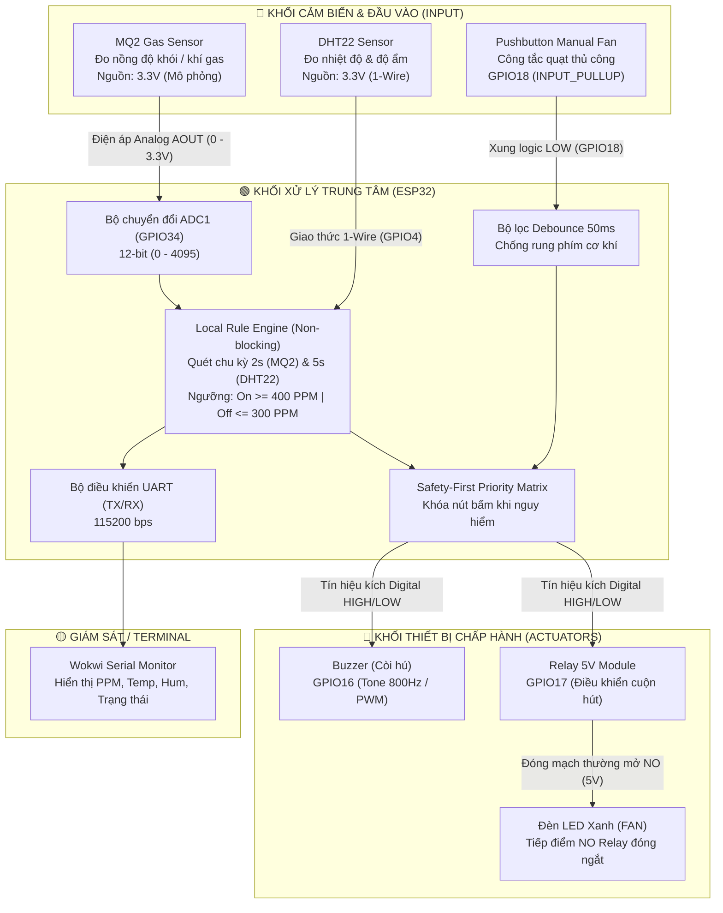

# Hệ Thống Báo Khói Cảnh Báo Sớm — Bảng Chi Tiết Mạch Phần Cứng Ảo & Luồng Tín Hiệu
## Đề tài: Hệ Thống Báo Khói Cảnh Báo Sớm — Nhóm N09 (Đề tài 4)
**Giảng viên hướng dẫn:** ThS. Võ Hoàng Hải  
**Thành viên:** Nguyễn Vĩnh Khang (Nhóm trưởng), Nguyễn Văn Đức, Nguyễn Văn Mãnh  

Hệ thống đã được đồng bộ hóa và đưa về **100% đúng theo thiết kế và phân tích trong tài liệu Word** (Chương 5, Chương 6, Chương 7) cùng các góp ý cải tiến sau Tuần 2 của Giảng viên hướng dẫn.

---

## 1. Sơ Đồ Kiến Trúc Khối Hệ Thống

> [!NOTE]
> **Cập nhật khắc phục lỗi kỹ thuật & tiếp thu góp ý GVHD:**
> - **DHT22:** Sử dụng hàm đọc chuẩn Adafruit Unified Sensor để triệt tiêu xung đột bus 1-Wire, đảm bảo hiển thị nhiệt độ và độ ẩm liên tục, không bị `NAN`.
> - **MQ2:** Áp dụng mô hình đặc tuyến điện trở Power-Law ($PPM = A \cdot (R_s/R_0)^B$) với phương pháp hiệu chuẩn thực nghiệm 2 điểm (200 & 1000 PPM), giúp đồng bộ 100% giữa thanh trượt Wokwi và Terminal. Chi tiết giải trình lý thuyết xem tại file [BaoCao_GiaiTrinh_Loi_DHT22_MQ2.md](file:///D:/BackUp_E/IoT/DoAn/BaoCao_GiaiTrinh_Loi_DHT22_MQ2.md).
> - **Nút nhấn công tắc thủ công (GPIO18):** Thêm nút bấm điều khiển quạt với Ma trận ưu tiên an toàn tuyệt đối (Safety-First).



---

## 2. Bảng Chi Tiết Từng Thành Phần Trong Mạch

| Tên thiết bị | Chức năng chính | Các mối nối (Chân nối & Công dụng) | Tín hiệu / Data đi như thế nào (Workflow) |
|---|---|---|---|
| **ESP32 DevKit-C V4** (`esp`) | **Bộ điều khiển trung tâm (MCU):**<br>- Lấy mẫu tín hiệu cảm biến định kỳ không dùng `delay()` (Non-blocking qua `millis()`).<br>- Tính toán quy đổi ADC sang PPM theo mô hình Power-Law.<br>- Chạy bộ quy tắc cảnh báo tại chỗ (Local Rule Engine) có trễ Hysteresis.<br>- Phân xử quyền ưu tiên giữa nút bấm thủ công và quy tắc an toàn tự động. | • `5V`: Cấp nguồn 5V cho Module Relay (cuộn hút + chân COM).<br>• `3V3`: Cấp nguồn 3.3V chuẩn cho DHT22 và MQ-2 (mô phỏng).<br>• `GND.1`: Mass chung cho MQ2, Buzzer và Nút bấm.<br>• `GND.2`: Mass chung cho DHT22, Relay và LED Fan.<br>• `GPIO34`: Chân ngõ vào Analog (ADC1) đọc điện áp từ MQ2.<br>• `GPIO4`: Chân ngõ vào/ra số đọc dữ liệu thời gian thực từ DHT22.<br>• `GPIO16`: Chân ngõ ra số điều khiển Buzzer qua hàm `tone()`.<br>• `GPIO17`: Chân ngõ ra số điều khiển Relay kích hoạt Quạt.<br>• `GPIO18`: Chân nhận tín hiệu nút bấm công tắc quạt thủ công.<br>• `TX / RX`: Đường truyền UART kết nối Serial Monitor. | 1. Nhận điện áp từ MQ2 qua GPIO34 mỗi 2000ms, bộ ADC 12-bit chuyển thành giá trị số `0 – 4095`.<br>2. Lấy trung bình 10 mẫu để lọc nhiễu gai, quy đổi: $R_s = R_L \times (V_{CC} - V_{out}) / V_{out}$, sau đó tính $PPM = A \times (R_s/R_0)^B$.<br>3. Nhận xung số 1-Wire từ DHT22 qua GPIO4 mỗi 5000ms, giải mã ra Nhiệt độ (°C) và Độ ẩm (%).<br>4. Đọc nút bấm GPIO18 liên tục mỗi vòng `loop()`, chống rung 50ms.<br>5. So sánh PPM với ngưỡng `400.0` và `300.0` theo ma trận ưu tiên an toàn:<br>   - Nếu $\ge 400.0$: bật còi và quạt, khóa quyền nút bấm.<br>   - Nếu $\le 300.0$: tắt còi, quạt theo trạng thái nút bấm.<br>6. Đóng gói chuỗi text và đẩy qua bộ đệm UART TX đến Serial Monitor. |
| **MQ2 Gas Sensor** (`mq2`) | **Cảm biến khói & khí cháy:**<br>- Phát hiện khói, khí gas LPG, Methane, Butane trong không khí.<br>- Lõi cảm biến gồm màng SnO2 nung nhiệt có điện trở thay đổi nghịch biến với nồng độ khói. | • `VCC`: Nối với `esp:3V3` (Cấp nguồn an toàn cho bộ đo ADC).<br>• `GND`: Nối với `esp:GND.1` (Mass chung).<br>• `AOUT`: Nối với `esp:34` (Xuất điện áp analog tỷ lệ thuận với nồng độ khói trong buồng đo). | 1. Khi có khói tiếp xúc bề mặt SnO2 nung nóng, các phân tử khí phản ứng oxy hóa làm giảm điện trở cảm biến Rs.<br>2. Theo nguyên lý mạch chia điện áp với điện trở tải RL (10kΩ), điện trở Rs giảm khiến điện áp trên chân `AOUT` tăng lên.<br>3. Tín hiệu điện áp analog liên tục được truyền thẳng qua dây nối vàng vào kênh `GPIO34` của ESP32. |
| **DHT22** (`dht`) | **Cảm biến nhiệt độ & độ ẩm:**<br>- Giám sát môi trường nhằm tăng cường độ tin cậy cảnh báo cháy nổ.<br>- Đo nhiệt độ từ -40°C đến +80°C (sai số ±0.5°C) và độ ẩm 0–100% RH (sai số ±2%). | • `VCC`: Nối với `esp:3V3` (Cấp nguồn 3.3V chuẩn cho cảm biến).<br>• `GND`: Nối với `esp:GND.2` (Mass chung).<br>• `SDA`: Nối với `esp:4` (Đường truyền dữ liệu số 1-Wire). | 1. Cứ mỗi chu kỳ 5 giây, vi điều khiển phát xung Start Signal trên chân GPIO4.<br>2. DHT22 nhận lệnh, kéo dây xuống rồi trả về chuỗi 40 xung bit dữ liệu số (16-bit độ ẩm, 16-bit nhiệt độ, 8-bit checksum).<br>3. Thư viện Adafruit đo độ dài các xung để giải mã ra giá trị số chính xác, lưu vào bộ nhớ cache. |
| **Active Buzzer** (`bz1`) | **Còi hú báo động âm thanh:**<br>- Phát ra tín hiệu âm thanh cảnh báo cư dân ngay tại hiện trường khi khói vượt ngưỡng. | • `Chân 1` (Dương): Nối với `esp:16` (Nhận tín hiệu xung điều khiển từ ESP32).<br>• `Chân 2` (Âm): Nối với `esp:GND.1` (Mass chung). | 1. Khi bình thường (PPM <= 300), GPIO16 giữ mức `LOW` (0V) → Còi ngắt.<br>2. Khi có sự cố (PPM >= 400), ESP32 phát xung tần số `tone(PIN_BUZZER, 800)` ra GPIO16 → Màng thạch anh dao động phát ra tiếng còi hú báo động 800Hz rõ ràng, không gây chói gắt. |
| **Relay 5V Module** (`relay1`) | **Rơ-le cách ly và đóng ngắt công suất:**<br>- Đóng/cắt dòng điện cung cấp cho quạt hút gió.<br>- Cách ly quang giữa mạch vi điều khiển (3.3V) và tải tiêu thụ quạt (5V hoặc 220V). | • `VCC`: Nối với `esp:5V` (Cấp nguồn cho cuộn hút nam châm điện).<br>• `GND`: Nối với `esp:GND.2` (Mass chung).<br>• `IN`: Nối với `esp:17` (Nhận tín hiệu điều khiển logic từ vi điều khiển).<br>• `COM`: Nối với `esp:5V` (Chân tiếp điểm chung nguồn cho quạt).<br>• `NO`: Nối với `led1:A` (Tiếp điểm thường mở - chỉ đóng mạch khi kích). | 1. Bình thường GPIO17 ở mức `LOW` → Tiếp điểm `NO` hở → Quạt (LED) không có điện.<br>2. Khi cần bật quạt (tự động khi cháy hoặc thủ công qua nút nhấn), GPIO17 xuất mức `HIGH` → Cuộn hút sinh từ trường đóng tiếp điểm `COM` nối sang `NO` → Dòng điện 5V truyền sang quạt. |
| **Đèn LED Xanh** (`led1` - FAN) | **Thiết bị mô phỏng động cơ Quạt hút:**<br>- Trực quan hóa trạng thái hoạt động của quạt thông gió thoát khói sự cố trên giao diện mô phỏng. | • `A` (Anode - Dương): Nối với tiếp điểm `relay1:NO`.<br>• `C` (Cathode - Âm): Nối với `esp:GND.2` (Mass chung). | 1. Khi tiếp điểm `NO` của Relay hở: Mạch hở, đèn LED tắt (Quạt ngừng).<br>2. Khi tiếp điểm `NO` đóng: Dòng điện 5V từ chân COM đi qua NO vào Anode và thoát về mass qua Cathode → Đèn LED phát sáng xanh tượng trưng cho quạt đang quay hút khói. |
| **Nút nhấn Pushbutton** (`btn1` - Manual Fan) | **Công tắc thủ công bật/tắt quạt:**<br>- Cho phép người vận hành chủ động bật/tắt quạt thông gió trong điều kiện môi trường bình thường. | • `Chân 1.l`: Nối với `esp:18` (Ngõ vào nhận diện phím bấm).<br>• `Chân 2.l`: Nối với `esp:GND.1` (Mass chung). | 1. Bình thường nút hở, điện trở kéo lên nội giữ chân GPIO18 ở mức `HIGH` (3.3V).<br>2. Khi người dùng nhấn nút, chân GPIO18 bị kéo sụt xuống mức `LOW` (0V).<br>3. Hàm `handleManualButton()` phát hiện cạnh xuống, chờ 50ms chống rung rồi đảo trạng thái quạt nếu hệ thống đang ở vùng an toàn. |

---

## 3. Phân Tích Chi Tiết 5 Tình Huống Vận Hành (Scenarios & Workflow)

```
Nồng độ khói (PPM)
 ^
 |             [TÌNH HUỐNG 3: BÁO ĐỘNG ĐỎ]
 |             PPM >= 400 -> BẬT CÒI & BẬT CƯỠNG BỨC QUẠT (KHÓA NÚT BẤM)
400 ----------+-----------------------------+----------------- (Ngưỡng kích hoạt ON)
 |            |                             |
 |    [TÌNH HUỐNG 2]                        |  [TÌNH HUỐNG 4: HỒI PHỤC]
 |    Chớm khói (150-399)                   |  Vùng trễ (300-400)
 |    Hệ thống chuẩn bị                     |  Vẫn duy trì quạt & còi
300 --+-------+-----------------------------+----------------- (Ngưỡng ngắt OFF)
 |    |                                     |
 |    |                                     v  PPM <= 300 -> TẮT CÒI (QUẠT THEO NÚT BẤM)
 |  [TÌNH HUỐNG 1: AN TOÀN]
 0  +--------------------------------------------------------> Thời gian
```

### 🔴 Tình huống 1: Môi trường an toàn, không có khói (Baseline)
- **Hiện tượng thực tế:** Trong phòng không khí sạch, không có tàn thuốc hay khí gas rò rỉ (Slider Wokwi ở mức thấp, ví dụ 0 – 150 PPM).
- **Tại sao xảy ra:** Nồng độ khí phản ứng thấp, điện trở cảm biến SnO2 ở mức cao, điện áp AOUT xuất ra thấp (~0.05V - 0.5V).
- **Đường đi tín hiệu:**
  - `MQ2:AOUT` → truyền điện áp thấp vào `ESP32:GPIO34`.
  - Bộ ADC đọc giá trị, tính toán `PPM <= 300.0`.
  - ESP32 nhận định: Không có nguy cơ cháy. Cờ `autoOverrideActive = false`.
  - Buzzer tắt (`GPIO16 = LOW`).
  - Quạt được điều khiển tự do theo trạng thái nút bấm thủ công `manualFanState`.
- **Kết quả trả ra:**
  - Còi im lặng.
  - Quạt (LED) bật hoặc tắt tùy người dùng nhấn nút.
  - Terminal in định kỳ: `[SENSOR-MQ2] PPM Khoi: 150.0`.

---

### 🟡 Tình huống 2: Chớm xuất hiện khói nhẹ hoặc nồng độ tăng dần (Pre-alarm)
- **Hiện tượng thực tế:** Có người thắp hương, hút thuốc lá hoặc thức ăn bị cháy nhẹ (Slider Wokwi kéo lên khoảng 200 – 390 PPM).
- **Tại sao xảy ra:** Các hạt khói bắt đầu tiếp xúc màng cảm biến, điện trở Rs giảm dần, điện áp `AOUT` tăng lên (khoảng 0.8V – 1.6V), nhưng nồng độ chưa đến mức nguy hiểm cấp bách.
- **Đường đi tín hiệu:**
  - `MQ2:AOUT` → điện áp trung bình truyền vào `ESP32:GPIO34`.
  - ESP32 tính ra `PPM` nằm trong khoảng `[300.1, 399.9]`.
  - Thuật toán kiểm tra: chưa chạm ngưỡng $\ge 400.0\text{ PPM}$.
- **Kết quả trả ra:**
  - Không kích hoạt báo động giả: Còi vẫn im lặng, không gây hoang mang.
  - Terminal hiển thị định kỳ giá trị PPM đang tăng dần để theo dõi từ xa.

---

### 🚨 Tình huống 3: Khói đậm đặc, phát hiện hỏa hoạn (Hazard / Alarm ON)
- **Hiện tượng thực tế:** Chập điện phát sinh khói đen hoặc bình gas rò rỉ nặng (Slider Wokwi kéo lên $\ge 400\text{ PPM}$).
- **Tại sao xảy ra:** Khói đậm làm điện trở SnO2 sụt giảm mạnh, điện áp `AOUT` tăng cao đưa vào GPIO34.
- **Đường đi tín hiệu:**
  1. `MQ2:AOUT` → Điện áp cao đưa vào `GPIO34`.
  2. Hàm `readMQ2PPM()` đọc ADC, tính ra `currentPPM >= 400.0`.
  3. Bộ vi điều khiển kích hoạt nhánh logic an toàn tuyệt đối:
     - Kích hoạt cờ cưỡng bức: `autoOverrideActive = true`.
     - Gọi `setBuzzer(true)` → phát xung âm thanh 800Hz ra còi hú.
     - Gọi `setFan(true)` → kích GPIO17 đóng Relay, cấp điện 5V cho quạt hút khói.
     - **Khóa quyền nút bấm:** Nếu có người bấm nút GPIO18, firmware từ chối và in cảnh báo ra Serial Monitor: `[BUTTON] BI KHOA! PPM dang trong vung nguy hiem...`.
- **Kết quả trả ra:**
  - Còi hú báo động vang lên tức thì.
  - Đèn LED xanh sáng (Quạt hút khói khẩn cấp vận hành hết công suất).
  - Terminal in cảnh báo: `[CANH BAO] === PPM VUOT NGUONG BAO DONG! ===`.

---

### 🔄 Tình huống 4: Quạt hút khói hoạt động và nồng độ giảm dần (Hysteresis Recovery)
- **Hiện tượng thực tế:** Sau khi quạt hút hoạt động hoặc đám cháy được khống chế, khói tản dần (Slider kéo giảm từ 600 xuống 350 rồi xuống dưới 300 PPM).
- **Tại sao xảy ra:** Hiện tượng quán tính môi trường. Nếu tắt quạt ngay khi PPM giảm xuống 399 thì khói quẩn lại có thể làm hệ thống bật/tắt liên tục (chập chờn, cháy relay).
- **Đường đi tín hiệu:**
  - **Giai đoạn 350 PPM (Vùng trễ Hysteresis):**
    - `currentPPM` ở mức 350 PPM (nằm giữa 300 và 400).
    - Code không thỏa mãn `PPM >= 400` cũng không thỏa mãn `PPM <= 300` → Trạng thái cũ được duy trì: **Còi và Quạt vẫn tiếp tục BẬT**.
  - **Giai đoạn <= 300 PPM (Khói đã được dập tắt an toàn):**
    - `currentPPM <= 300.0` thỏa mãn điều kiện `else if`.
    - ESP32 giải trừ cờ cưỡng bức: `autoOverrideActive = false`.
    - Còi ngắt ngay lập tức (`setBuzzer(false)`).
    - Hoàn trả quyền điều khiển quạt cho nút nhấn thủ công (`setFan(manualFanState)`).
- **Kết quả trả ra:** Hệ thống chuyển về trạng thái giám sát bình thường một cách ổn định, mượt mà.

---

### ⚠️ Tình huống 5: Cảm biến nhiệt ẩm DHT22 gặp lỗi đứt dây hoặc mất nguồn
- **Hiện tượng thực tế:** Dây nối chân SDA (GPIO4) bị lỏng hoặc cảm biến bị hỏng phần cứng.
- **Tại sao xảy ra:** Không có tín hiệu phản hồi 1-Wire, hàm thư viện trả về `NAN`.
- **Đường đi tín hiệu:**
  - Lệnh `dht.readTemperature()` hoặc `dht.readHumidity()` trả về `NAN`.
  - Điều kiện kiểm tra `if (!isnan(t) && !isnan(h))` trả về `false`.
  - Nhánh `else` được kích hoạt.
- **Kết quả trả ra:**
  - Terminal thông báo lỗi: `[ERROR] Khong the doc du lieu tu DHT22!`.
  - ESP32 không bị treo (crash), hệ thống báo khói MQ2 và còi/quạt vẫn hoạt động độc lập bình thường nhờ kiến trúc Non-blocking timer.

---

## 4. Bảng Tra Cứu Quy Đổi Nồng Độ & Điện Áp (Mô Hình Power-Law Thực Nghiệm)

Phương trình hiệu chuẩn thực nghiệm 2 điểm trên Wokwi:
$$\text{PPM} = 741.6 \times \left(\frac{R_s}{R_0}\right)^{-2.444} \quad (R_0 = 10.0\text{ k}\Omega)$$

| Mức Độ Khói Thực Tế | Điện Áp AOUT (V) | Giá Trị Điện Trở Rs (kΩ) | Giá Trị PPM Quy Đổi | Trạng Thái Còi (Buzzer) | Trạng Thái Quạt (Relay FAN) | Quyền Nút Nhấn (GPIO18) |
|---|:---:|:---:|:---:|:---:|:---:|:---:|
| Không khí sạch (Chuẩn) | 0.40 V – 1.00 V | 72.5 – 23.0 kΩ | 10 – 120 PPM | ❌ TẮT | Theo nút bấm | ✅ Cho phép |
| Khói nhẹ / Bếp ăn | 1.10 V – 1.60 V | 20.0 – 10.6 kΩ | 150 – 299 PPM | ❌ TẮT | Theo nút bấm | ✅ Cho phép |
| Khói trung bình (Vùng trễ) | 1.61 V – 1.95 V | 10.5 – 6.9 kΩ | 300 – 399 PPM | 🔄 Giữ trạng thái cũ | 🔄 Giữ trạng thái cũ | 🔄 Giữ trạng thái cũ |
| Ngưỡng báo động (Cảnh báo) | 1.96 V | $\approx 6.8\text{ k}\Omega$ | 400 PPM | 🔔 BẬT (Hú 800Hz) | 🌀 BẬT CƯỠNG BỨC | ⛔ Bị khóa |
| Khói đậm đặc (Hỏa hoạn) | 2.50 V – 3.25 V | 3.2 – 0.15 kΩ | 1.000 – 100.000 PPM | 🔔 BẬT (Hú 800Hz) | 🌀 BẬT CƯỠNG BỨC | ⛔ Bị khóa |
