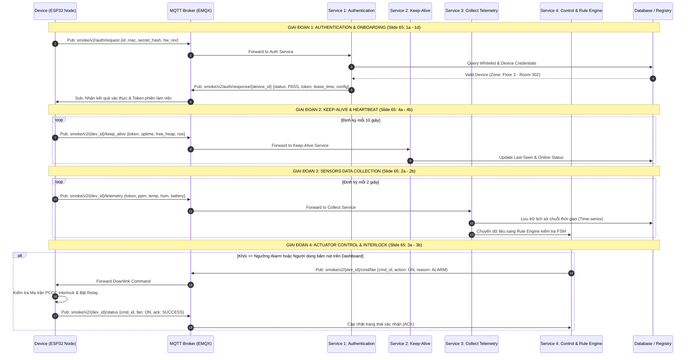

# KẾ HOẠCH NÂNG CẤP & HOÀN THIỆN ĐỒ ÁN THEO GÓP Ý CỦA GIẢNG VIÊN HƯỚNG DẪN
> **Đề tài 04:** Hệ thống báo khói cảnh báo sớm  
> **Nhóm thực hiện:** Nhóm 09 (N09) - Lớp IoT IoT  
> **Giảng viên hướng dẫn:** ThS. Võ Hoàng Hải  
> **Căn cứ kỹ thuật:** Slide 65–67 bài giảng [3. Lập trình IoT.pptx](file:///e:/IoT/DoAn/docs/pdf/3.%20Lập%20trình%20IoT.pptx) và Kế hoạch 10 tuần – 60h.

---

## I. TỔNG HỢP & PHÂN TÍCH CÁC GÓP Ý CỦA GIẢNG VIÊN

| STT | Nội dung góp ý của Giảng viên | Căn cứ trong Slide bài giảng | Vấn đề hiện tại của dự án | Giải pháp nâng cấp đề xuất |
| :-: | :--- | :--- | :--- | :--- |
| **1** | **Thiết kế chi tiết Message & Payload (Slide 65)** và bổ sung vào báo cáo | **Slide 65:** Kiến trúc 4 dịch vụ độc lập (`Authentication`, `Collect`, `Control`, `Keep_alive`) kết nối Database; luồng trao đổi 4 cặp tín hiệu `(1a)-(1d)`, `(2a)-(2b)`, `(3a)-(3b)`, `(4a)-(4b)`. | Hiện tại hệ thống trao đổi JSON cơ bản, gắn cứng topic đơn lẻ (`smoke/telemetry`, `smoke/cmd/fan`), chưa có lớp xác thực (Auth Handshake), chưa có mã định danh thiết bị linh hoạt. | Chuẩn hóa toàn bộ Topic Tree và Payload Schema theo kiến trúc 4 dịch vụ Slide 65, bổ sung cơ chế Handshake xác thực `(id, passwd/token) -> Session Key` và cặp gói tin Keep-alive độc lập. |
| **2** | **Bộ tín hiệu giao tiếp MQTTX & Cấu trúc code mở rộng được** | **Slide 66–67:** Kiến trúc Firmware đa nhiệm FreeRTOS, Message Queue, tách lớp phần cứng và giao thức mạng. | Code `src/main.cpp` còn xử lý lồng ghép giữa đọc cảm biến và gửi MQTT; bộ mẫu MQTTX còn mang tính thủ công, chưa có từ điển tín hiệu (Signal Map / Payload Dictionary) chuẩn. | - Xây dựng **Signal Map & Payload Dictionary** chuẩn hóa.<br>- Cấu trúc lại mã nguồn theo hướng **Modular Event-Driven**: Tách riêng `SensorManager`, `ActuatorController`, `MqttDispatcher`, `SecurityInterlock`.<br>- Xuất file Collection kịch bản kiểm thử MQTTX sẵn sàng nạp 1-click. |
| **3** | **Cơ chế Scale (Khả năng mở rộng quy mô)** | **Slide 64 & 65:** Mô hình đa thiết bị (nhiều Device cùng kết nối Broker và Server). | Thiết kế ban đầu chỉ phục vụ 1 ESP32 duy nhất, chưa tính đến bài toán mở rộng 10, 100 hay 1.000 cảm biến khói cho tòa nhà nhiều tầng. | - Thiết kế **Topic Tree đa cấp độ** hỗ trợ Wildcard: `smoke/v2/{building_id}/{zone_id}/{device_id}/{channel}`.<br>- Kiến trúc Middleware Node-RED xử lý **Stateless Router**, lưu trữ Metadata thiết bị vào Dynamic Registry. |
| **4** | **Kiểm soát khi thêm 1 hoặc nhiều thiết bị (Onboarding & Fleet Management)** | **Slide 65:** Dịch vụ Authentication kiểm tra ID/Passwd với Database để cấp quyền gửi Sensors Data. | Chưa có cơ chế phát hiện thiết bị lạ; khi gắn thêm ESP32 mới phải cấu hình tĩnh từng topic bằng tay. | - Xây dựng quy trình **Onboarding Handshake**: Thiết bị mới gửi bản tin `provisioning/request` $\rightarrow$ Server kiểm tra Whitelist $\rightarrow$ Cấp phát `Device_ID` và `Session_Key`.<br>- Bảng giám sát đoàn thiết bị (**Device Fleet Dashboard**) theo dõi trạng thái sống/chết (Alive/Dead), RSSI, pin và vị trí không gian (Zone/Room). |

---

## II. THIẾT KẾ KIẾN TRÚC HỆ THỐNG MỚI (CHUẨN HÓA THEO SLIDE 65)

### 1. Sơ đồ luồng tương tác 4 Dịch vụ cốt lõi



---

## III. CHI TIẾT ĐẶC TẢ MESSAGE & PAYLOAD SCHEMA (SLIDE 65)

Toàn bộ thông điệp được chuẩn hóa bằng định dạng **JSON Schema Draft 7**, có Header xác thực bảo vệ và phân định rõ mục đích:

### 1. Dịch vụ Xác thực & Đăng ký thiết bị (Authentication Service)
- **(1a) Publish Auth Request:**
  - Topic: `smoke/v2/auth/request`
  - Payload:
    ```json
    {
      "msg_id": "REQ-AUTH-001",
      "device_id": "ESP32_SMOKE_N09_A01",
      "mac_address": "24:6F:28:AB:CD:EF",
      "device_type": "SMOKE_DETECTOR_NODE",
      "hw_version": "v1.2",
      "fw_version": "v2.0.1",
      "secret_token": "a1b2c3d4e5f67890",
      "timestamp": 1728130000
    }
    ```
- **(1d) Subscribe Auth Result (Trả về cho thiết bị):**
  - Topic: `smoke/v2/auth/response/ESP32_SMOKE_N09_A01`
  - Payload:
    ```json
    {
      "msg_id": "RESP-AUTH-001",
      "status": "PASS",               // PASS | REJECT_UNAUTHORIZED | REJECT_BLACKLISTED
      "session_key": "SK_9876543210_SECURE",
      "lease_duration_sec": 86400,
      "assigned_zone": "Building_A/Floor_03/Room_302",
      "config": {
        "telemetry_interval_ms": 2000,
        "keep_alive_interval_ms": 10000,
        "alarm_threshold_ppm": 400.0,
        "safe_threshold_ppm": 300.0
      }
    }
    ```

### 2. Dịch vụ Thu thập dữ liệu cảm biến (Collect Service)
- **(2a) Publish Sensors Data:**
  - Topic: `smoke/v2/Building_A/Floor_03/Room_302/ESP32_SMOKE_N09_A01/telemetry`
  - Payload:
    ```json
    {
      "session_key": "SK_9876543210_SECURE",
      "device_id": "ESP32_SMOKE_N09_A01",
      "seq": 1045,
      "timestamp": 1728130020,
      "sensors": {
        "mq2_ppm": 145.2,
        "temperature_c": 28.4,
        "humidity_pct": 62.5
      },
      "actuators_state": {
        "fan": "OFF",
        "buzzer": "OFF"
      },
      "system_flags": {
        "sensor_healthy": true,
        "mode": "AUTO"
      }
    }
    ```

### 3. Dịch vụ Điều khiển thiết bị chấp hành (Control Service)
- **(3a) Publish Control Command (Server xuống Device):**
  - Topic: `smoke/v2/Building_A/Floor_03/Room_302/ESP32_SMOKE_N09_A01/cmd/fan`
  - Payload:
    ```json
    {
      "cmd_id": "CMD-20261005-0089",
      "action": "ON",                   // ON | OFF | TOGGLE
      "target": "EXHAUST_FAN_RELAY",
      "priority": "HIGH",               // LOW | NORMAL | HIGH | CRITICAL
      "timeout_sec": 30,
      "reason": "RULE_1_SMOKE_ALARM",
      "issued_by": "AUTOMATION_ENGINE"
    }
    ```
- **(3b) Device Phản hồi Trạng thái & Xác nhận lệnh (ACK):**
  - Topic: `smoke/v2/Building_A/Floor_03/Room_302/ESP32_SMOKE_N09_A01/status`
  - Payload:
    ```json
    {
      "cmd_id": "CMD-20261005-0089",
      "execution_status": "SUCCESS",   // SUCCESS | FAILED | REJECTED_SAFETY_LOCK
      "current_fan_state": "ON",
      "safety_interlock_active": true,
      "current_ppm": 462.8,
      "timestamp": 1728130022
    }
    ```

### 4. Dịch vụ Giám sát nhịp tim (Keep-alive Service)
- **(4a) Publish Keep-Alive Heartbeat:**
  - Topic: `smoke/v2/Building_A/Floor_03/Room_302/ESP32_SMOKE_N09_A01/keep_alive`
  - Payload:
    ```json
    {
      "session_key": "SK_9876543210_SECURE",
      "device_id": "ESP32_SMOKE_N09_A01",
      "uptime_sec": 3600,
      "free_heap_bytes": 184520,
      "wifi_rssi_dbm": -58,
      "status": "HEALTHY"
    }
    ```

---

## IV. BỘ TÍN HIỆU GIAO TIẾP & KIẾN TRÚC CODE MỞ RỘNG (MODULAR EXTENSIBLE ARCHITECTURE)

### 1. Cấu trúc mã nguồn Firmware ESP32 mở rộng (FreeRTOS & Modular Design)
Hiện thực hóa theo **Slide 66 & 67** bằng cách chia tách mã nguồn thành các module độc lập:

```
src/
├── main.cpp                  # Khởi tạo FreeRTOS Tasks và Queue
├── config/
│   └── SystemConfig.h        # Cấu hình chân GPIO, Broker, Device UUID, Whitelist
├── core/
│   ├── FreeRTOSTasks.h       # Task 1 (MQTT), Task 2 (Sensors), Task 3 (Actuators), Task 4/5 (KeepAlive)
│   └── StateMachine.h        # Quản lý 5 trạng thái FSM (SAFE, WARNING, ALARM, COOLDOWN, OFFLINE)
├── network/
│   ├── MqttClientManager.h   # Quản lý kết nối MQTT, Non-blocking reconnect, QoS, LWT
│   ├── AuthHandler.h         # Quản lý Handshake xác thực và lưu trữ Session Key
│   └── MessageDispatcher.h   # Định tuyến và phân tích các gói tin Downlink
├── hal/
│   ├── SensorRegistry.h      # Lớp trừu tượng quản lý cảm biến (dễ dàng gắn thêm MQ-135, CO, Flame)
│   ├── ActuatorRegistry.h    # Lớp trừu tượng quản lý cơ cấu chấp hành (Relay, Servo, Buzzer)
│   └── SafetyInterlock.h     # Ma trận bảo vệ an toàn PCCC cứng tại thiết bị
```

### 2. Bộ kịch bản & Signal Map cho MQTTX
Xây dựng file cấu hình **MQTTX Collection (.json)** để nạp trực tiếp vào công cụ kiểm thử:
- Tập lệnh mô phỏng Handshake xác thực (gửi Request $\rightarrow$ nhận Response PASS/FAIL).
- Tập lệnh mô phỏng gửi Telemetry định kỳ và sự kiện khẩn cấp.
- Tập lệnh gửi Downlink điều khiển Quạt, Còi với đầy đủ các mức ưu tiên (`LOW`, `NORMAL`, `HIGH`, `CRITICAL`).
- Kịch bản kiểm thử cố tình gửi sai Token để kiểm tra lớp phòng vệ của Middleware.

---

## V. CƠ CHẾ SCALE (MỞ RỘNG QUY MÔ HỆ THỐNG)

```
                            MÔ HÌNH SCALE ĐA TẦNG
                            
[Cụm Node Cảm biến Tầng 1]   [Cụm Node Cảm biến Tầng 2]   [Cụm Node Cảm biến Tầng 3]
  (Node 1.1, 1.2, 1.3, ...)    (Node 2.1, 2.2, 2.3, ...)    (Node 3.1, 3.2, 3.3, ...)
               \                           |                           /
                -------------------------------------------------------
                                           |
                                           v
                  +-------------------------------------------------+
                  |      MQTT BROKER CLUSTER (EMQX / Mosquitto)     |
                  |  Topic Tree: smoke/v2/{Building}/{Floor}/{Node}/|
                  +-------------------------------------------------+
                                           |
                   Wildcard Subscriptions: smoke/v2/+/+/+/+
                                           |
                                           v
                  +-------------------------------------------------+
                  |         TẦNG 3: MIDDLEWARE ENGINE               |
                  |                                                 |
                  |   [Router Worker 1]        [Router Worker 2]    |
                  |   (Xử lý Tầng 1-2)         (Xử lý Tầng 3-4)     |
                  |                                                 |
                  |         [Dynamic Device Registry Table]         |
                  |         (Quản lý danh sách N thiết bị)          |
                  |                                                 |
                  |         [Cross-Zone Automation Engine]          |
                  |         (Cháy 1 phòng -> Bật còi toàn sàn)      |
                  +-------------------------------------------------+
                                           |
                                           v
                  +-------------------------------------------------+
                  |        TẦNG 4: APPLICATION & DASHBOARD          |
                  |  - Giám sát toàn bộ tòa nhà (Multi-room Map)    |
                  |  - Báo động phân vùng (Zonal Alerting)          |
                  +-------------------------------------------------+
```

### 1. Topic Tree phân cấp hỗ trợ Wildcard
- Định dạng chuẩn: `smoke/v2/{building}/{floor}/{zone}/{device_id}/{channel}`
- Middleware chỉ cần đăng ký các Topic Wildcard thông minh:
  - Lắng nghe toàn bộ dữ liệu: `smoke/v2/+/+/+/+/telemetry`
  - Lắng nghe toàn bộ cảnh báo khẩn cấp: `smoke/v2/+/+/+/+/event/alarm`
  - Lắng nghe toàn bộ nhịp tim: `smoke/v2/+/+/+/+/keep_alive`

### 2. Xử lý Stateless & Dynamic Device Registry
- Middleware không gắn cứng (hardcode) tên hoặc IP thiết bị trong code.
- Mỗi bản tin mang theo `device_id` và `session_key`. Middleware tự động tra cứu bảng **Device Registry** (bảng băm trong bộ nhớ hoặc SQLite/MySQL):
  - Tra cứu ngưỡng kích hoạt riêng của từng phòng (ví dụ: Phòng bếp ngưỡng 500 PPM, Phòng ngủ ngưỡng 350 PPM).
  - Cập nhật thời điểm `last_seen` của từng thiết bị độc lập.

### 3. Quy tắc tự động hóa liên vùng (Cross-Zone Automation)
- Khi 1 node trong phòng phát hiện cháy lớn ($PPM \ge 600$), Middleware không chỉ bật quạt của phòng đó mà còn phát lệnh kích hoạt chuông báo cháy cho toàn bộ khu vực sàn (`smoke/v2/Building_A/Floor_03/+/cmd/buzzer`).

---

## VI. CƠ CHẾ KIỂM SOÁT THÊM 1 HOẶC NHIỀU THIẾT BỊ (DEVICE ONBOARDING & FLEET CONTROL)

### 1. Quy trình Cấp phát & Đăng ký thiết bị (Device Onboarding Lifecycle)

```
[THIẾT BỊ MỚI XUẤT XƯỞNG / MỚI GẮN VÀO HỆ THỐNG]
                         |
                         v
[Bước 1]: Thiết bị phát bản tin Auth Request kèm Hardware MAC & Secret Token
                         |
                         v
[Bước 2]: Server đối soát với Bảng Whitelist (Danh sách thiết bị hợp chuẩn)
      |                                              |
 (Không hợp lệ)                                 (Hợp lệ)
      v                                              v
Từ chối (AUTH_REJECT)                      Cấp phát Session Key & Phân vùng (Zone)
Chặn kết nối vào Broker                     Gửi cấu hình ngưỡng đo xuống thiết bị
                                                     |
                                                     v
                                  [Bước 3]: Đưa vào Danh bạ Device Registry
                                  - Đánh dấu trạng thái: ONLINE
                                  - Bắt đầu chu trình giám sát Watchdog
```

### 2. Bảng Giám sát Hạm đội Thiết bị (Fleet Management Table)
Trên giao diện quản trị Node-RED Dashboard / Application, bổ sung bảng danh bạ thiết bị thời gian thực:

| Mã Node (Device ID) | Vị trí phân vùng (Zone) | Địa chỉ MAC | Trạng thái | Nồng độ khói | Nhiệt độ | RSSI WiFi | Tình trạng pin/nguồn | Hành động can thiệp |
| :--- | :--- | :--- | :---: | :---: | :---: | :---: | :---: | :---: |
| `ESP32_SMOKE_N09_A01` | Tòa A - P.301 (Bếp) | `24:6F:28:AB:01` | 🟢 Online | 145 PPM | 31.2°C | -55 dBm | 100% (AC) | [Test] [Reboot] |
| `ESP32_SMOKE_N09_A02` | Tòa A - P.302 (Ngủ) | `24:6F:28:AB:02` | 🟢 Online | 110 PPM | 27.5°C | -62 dBm | 98% (AC) | [Test] [Reboot] |
| `ESP32_SMOKE_N09_A03` | Tòa A - P.303 (Kho) | `24:6F:28:AB:03` | 🔴 Offline | N/A | N/A | Mất sóng | 15% (Cảnh báo) | [Kiểm tra] |

---

## VII. KẾ HOẠCH THỰC HIỆN & PHÂN CÔNG CHI TIẾT (ACTION PLAN)

Kế hoạch được chia thành **4 giai đoạn** cụ thể:

### Giai đoạn 1: Chuẩn hóa Thiết kế chi tiết & Tài liệu (1.5 ngày)
- [ ] Soạn thảo phụ lục thiết kế chi tiết: Bộ từ điển Message Dictionary & JSON Schema đầy đủ 4 dịch vụ Slide 65.
- [ ] Bổ sung nội dung thiết kế chi tiết, cơ chế Scale và kiểm soát đa thiết bị vào [Phần 4.docx](file:///e:/IoT/DoAn/docs/word/Phần%204.docx) và [Phần 5.docx](file:///e:/IoT/DoAn/docs/word/Phần%205.docx).
- [ ] Tạo file mô tả chuẩn tín hiệu: `docs/md/Thiet_Ke_Chi_Tiet_Message_Payload_Slide65.md`.

### Giai đoạn 2: Cấu trúc lại Firmware ESP32 theo kiến trúc Mở rộng (2 ngày)
- [ ] Tách mã nguồn `src/main.cpp` thành kiến trúc module FreeRTOS Task (Task 1: Event/Auth, Task 2: Sensor, Task 3: Actuator, Task 4: KeepAlive).
- [ ] Hiện thực hóa quy trình bắt tay xác thực (Auth Handshake) với Server để nhận Session Key trước khi Publish Telemetry.
- [ ] Hỗ trợ thay đổi ngưỡng động (Dynamic Threshold Config) nhận từ Server thay vì hardcode.
- [ ] Kiểm thử biên dịch trên PlatformIO và xác nhận hoạt động ổn định trên Wokwi.

### Giai đoạn 3: Nâng cấp Tầng 3 Middleware Node-RED đa thiết bị (1.5 ngày)
- [ ] Nâng cấp [flows_smoke_detector.json](file:///e:/IoT/DoAn/nodered/flows_smoke_detector.json):
  - Bổ sung Node xử lý dịch vụ Authentication (kiểm tra Whitelist và sinh Session Key).
  - Chuyển đổi topic sang cấu trúc Wildcard đa cấp độ `smoke/v2/+/+/+/+`.
  - Quản lý Máy trạng thái FSM độc lập cho từng thiết bị dựa trên Bảng băm Context (`flow.get("devices")`).
  - Hiện thực quy tắc tự động hóa liên vùng (Cross-zone Emergency).
- [ ] Bổ sung giao diện Fleet Management Dashboard hiển thị danh sách nhiều thiết bị.

### Giai đoạn 4: Xây dựng Bộ công cụ Kiểm thử MQTTX & Báo cáo hoàn chỉnh (1 ngày)
- [ ] Tạo file kịch bản MQTTX Collection: `tests/mqttx_collection_slide65.json` hỗ trợ nạp vào phần mềm MQTTX để kiểm tra đầy đủ 4 luồng dịch vụ.
- [ ] Cập nhật kịch bản kiểm thử tự động Python [test_middleware_simulator.py](file:///e:/IoT/DoAn/test_middleware_simulator.py) để mô phỏng đồng thời 3–5 thiết bị ảo cùng lúc.
- [ ] Cập nhật bảng kiểm thử [Bang_Test_Case_Tuan5_Nhom04.docx](file:///e:/IoT/DoAn/docs/word/Bang_Test_Case_Tuan5_Nhom04.docx) bổ sung các test case: Xác thực sai bị từ chối, Thêm thiết bị mới thành công, Mất sóng từng thiết bị, Cảnh báo liên phòng.
- [ ] Ghi nhận toàn bộ tiến trình vào [Lich_Su_Tro_Chuyen.md](file:///e:/IoT/DoAn/docs/md/Lich_Su_Tro_Chuyen.md).

---

## VIII. KẾT QUẢ ĐẦU RA KỲ VỌNG (DELIVERABLES)
1. **Tài liệu Báo cáo hoàn chỉnh:** File Word [Phần 4.docx](file:///e:/IoT/DoAn/docs/word/Phần%204.docx) và [Phần 5.docx](file:///e:/IoT/DoAn/docs/word/Phần%205.docx) được cập nhật thêm mục "Thiết kế chi tiết Message & Payload theo chuẩn Slide 65", "Kiến trúc Mở rộng & Cơ chế Scale", "Quy trình Onboarding kiểm soát đa thiết bị".
2. **Firmware ESP32:** Mã nguồn chuẩn hóa theo Slide 66–67 (Modular FreeRTOS, Auth Handshake, Dynamic Config).
3. **Node-RED Flow:** Hệ thống Middleware quản lý hạm đội đa thiết bị, có xác thực và giám sát nhịp tim Keep-alive độc lập.
4. **Bộ kiểm thử MQTTX & Python:** File cấu hình kiểm thử sẵn sàng để demo trước Giảng viên hướng dẫn bất kỳ tình huống nào.

